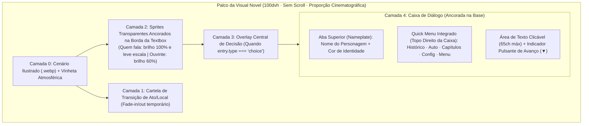

# Análise Estética, Direção de UI/UX e Acessibilidade — CYBER (Visual Novel)

> **Contexto analisado:** Jogo educativo no formato *Visual Novel* integrante da ação de extensão **Bytes para a Cidadania — Cyber** (Curso de Tecnologia em ADS · Disciplina de Projeto Social), voltado a estudantes do **Ensino Fundamental II** para aplicação tanto individual (computadores escolares e celulares) quanto coletiva/colaborativa em sala de aula (exibição em **projetor** com mediação da equipe).

---

## 1. Visão Geral e Diagnóstico de Contexto

O projeto **CYBER** já possui uma fundação narrativa e técnica sólida:
- **Três capítulos completos em formato antológico** conectados pela transição *“Enquanto isso...”* (Cap. 1: *André* e os boatos na véspera do concurso; Cap. 2: *Lia* e o *clickbait*/telefone sem fio na rádio escolar; Cap. 3: *Nina* e o golpe de *phishing*/permissões abusivas na rede Vitra).
- **13 cenários ilustrados em alta qualidade (`public/backgrounds/*.webp`)** que seguem a direção artística definida na documentação: pintura digital em estilo anime contemporâneo, com forte contraste entre a iluminação interna acolhedora (tons âmbar/quentes inspirados na atmosfera *cozy* de *Coffee Talk*) e a luz fria das telas e do exterior noturno.
- **7 personagens ilustrados em estilo anime (`public/characters/*`)**, cada um com 6 expressões faciais mapeadas no roteiro.

Contudo, **a camada de interface (HTML/CSS/JSX) e o tratamento técnico dos recortes de personagens ainda operam com paradigmas de desenvolvimento web tradicional (sites, blogs e dashboards)**, criando um choque visual entre a arte ilustrada de fundo e os componentes na tela.

Abaixo, detalha-se **tudo o que faz o jogo parecer uma página web hoje**, **como remover essas peculiaridades** e **quais mudanças visuais e de acessibilidade devem ser aplicadas** para consolidar uma estética autêntica de Visual Novel comercial/indie.

---

## 2. O Que Faz o Jogo Parecer uma Página Web (e Como Remover)

### 2.1. Peculiaridades de "Site" Identificadas no Código Atual

| # | Elemento / Arquivo | Por que parece uma página web? | Como funciona em uma Visual Novel real (O que fazer) |
| :--- | :--- | :--- | :--- |
| **1** | **Barra de navegação superior (`.story-topbar`)**<br>`src/story/components/StoryScreen.jsx`<br>`src/styles.css` (L163–170) | O `<header className="story-topbar">` ocupa toda a largura superior como uma *navbar* de site institucional, exibindo metadados fixos (`CAPÍTULO 1 · Três anos de preparação / Ato 1 · Protagonista: André`) à esquerda e botões retangulares (`CAPÍTULOS`, `MENU`) à direita. | **Remover a navbar superior.** Metadados de Capítulo e Ato devem aparecer como uma **cartela cinematográfica temporária (*Act Title Card*)** por 2 segundos na mudança de ato e depois sumir para liberar a arte do cenário. Os controles de sistema devem virar um **Quick Menu compacto** acoplado à própria caixa de diálogo ou em ícones discretos no canto. |
| **2** | **Etiqueta metalinguística no palco (`.story-stage__setting`)**<br>`src/story/components/StoryScreen.jsx` (L74–77) | Renderiza um bloco com `<small>Cenário ilustrado · história fictícia</small>` permanentemente no canto superior esquerdo de todas as cenas. Isso tem aparência de aviso técnico de *wireframe*/protótipo e quebra a suspensão de descrença (*quebra de imersão*). | **Retirar imediatamente a frase `"Cenário ilustrado · história fictícia"` do palco.** Transformar a indicação de local e tempo (`Quarto de estudos · noite`) em um *Location Badge* diegético discreto ou exibi-la apenas na transição de entrada da cena. |
| **3** | **Avanço restrito a um botão de texto (`MOSTRAR TEXTO ›` / `CONTINUAR ›`)**<br>`src/story/components/DialoguePanel.jsx` (L87–89) | Em páginas web, o usuário clica em botões de formulário/links (`<button>CONTINUAR</button>`). No jogo atual, clicar na caixa de diálogo ou no cenário com o mouse **não faz nada**; o jogador é obrigado a mirar num pequeno botão de texto no canto inferior direito. | **Tornar toda a caixa de diálogo (e o palco livre) clicável** para completar a linha atual ou avançar para a próxima fala. Substituir o botão de texto `MOSTRAR TEXTO / CONTINUAR` por um **indicador gráfico animado de avanço (*Click-To-Continue / CTC glyph*, como `▼` ou `❖`)** que pulsa suavemente no fim da frase. |
| **4** | **Rótulo de quem fala dentro do fluxo do card (`.story-dialogue__speaker`) e rótulo `"NARRAÇÃO"`**<br>`src/story/components/DialoguePanel.jsx` (L76–85) | O nome do personagem é apenas um `<p>` de `12px` dentro do retângulo da caixa, idêntico a um *category kicker* de post de blog. Além disso, quando o narrador fala, aparece escrito literalmente `NARRAÇÃO` no topo do card. | **Criar um *Nameplate* (placa de nome) destacado**, ancorado sobre a borda superior esquerda da caixa de diálogo, com tamanho legível e identidade própria. **Em falas de `narration`, ocultar o *Nameplate*** (a ausência de nome já comunica universalmente que é narração em Visual Novels). |
| **5** | **Escolhas substituindo a caixa de diálogo como um formulário (`.story-dialogue--choices`)**<br>`src/story/components/DialoguePanel.jsx` (L52–74) | Quando há uma decisão, a caixa de diálogo desaparece e dá lugar a um bloco com o título `SUA ESCOLHA`, uma pergunta em `<h2>` e botões alinhados como uma enquete de site. | **Manter a pergunta na caixa de diálogo inferior e exibir as opções de escolha flutuando no centro do palco** (com leve escurecimento de fundo e destaque visual ao focar/passar o mouse), criando o impacto dramático clássico de decisão em Visual Novels. |
| **6** | **Recortes de personagens com fundo branco e flutuando desconectados (`.story-portrait`)**<br>`public/characters/*`<br>`src/styles.css` (L173–174) | Os arquivos PNG atuais possuem **fundo branco opaco** (os protagonistas como cartões verticais de cantos arredondados; os secundários como quadrados `512x512` gerados por `../recortar_secundarios.py`, sendo que `tomas/01_normal.png` tem inclusive vazamento do frame lateral no canto inferior direito). Além disso, estão posicionados em `bottom: clamp(165px, 23vh, 240px)`, flutuando com um corte reto/curvo no ar acima da caixa de diálogo, parecendo um avatar de site colado sobre um *wallpaper*. | **Remover o fundo branco (canal alfa transparente)** e padronizar os sprites em **Spritesheets WebP** (conforme já estudado em `../planejamento.md`). **Ancorar a base do personagem exatamente na borda superior da caixa de diálogo** (ou em um *Portrait Frame* lateral integrado à caixa de diálogo), eliminando o corte flutuante no meio da tela. |
| **7** | **Fluxo de página flexível (`min-height: 100svh`) em vez de tela de jogo fixa**<br>`src/styles.css` (L23, L145, L150, L227) | Regras como `min-height: 100svh` e `@media (max-height: 620px) { .story-stage { min-height: 620px; } }` geram barra de rolagem de navegador em janelas menores e posicionam os elementos por fluxo de documento (`margin: auto`). | **Travar o palco em `height: 100dvh; overflow: hidden`** com layout em camadas absolutas/grid de jogo (Cenário $\rightarrow$ Personagens $\rightarrow$ Camada de Escolhas $\rightarrow$ HUD de Diálogo $\rightarrow$ Modais). |
| **8** | **Controles de formulário HTML nativos e botões com setas de texto (`←`, `→`)**<br>`src/components/SettingsModal.jsx`<br>`src/components/ChaptersModal.jsx` | O modal de Configurações usa `<select>`, `<input type="checkbox">` e `<input type="range">` com aparência padrão do sistema operacional. Os botões usam textos de link web como `← VOLTAR AO MENU` e `INICIAR CAPÍTULO 1 →`. | **Substituir `<select>` de velocidade de texto por botões segmentados (*pill buttons*)**, o checkbox por um *toggle switch* de jogo e remover setas ASCII/Unicode de link (`←`/`→`) dos botões de ação. |
| **9** | **Menu principal com textos soltos entre os botões e rodapé institucional**<br>`src/components/MainMenu.jsx` (L45–64) | Textos explicativos (`.menu-nav__hint`, `.menu-nav__development`) ficam inseridos no meio da lista vertical de botões como dicas de formulário, e o fundo `.scene` é um gradiente azul abstrato sem atmosfera narrativa. | **Limpar a lista de botões do Menu Principal**, exibindo o resumo do progresso salvo em um **painel/badge de save elegante ao lado ou abaixo do menu** quando "Continuar" estiver focado/ativo, e integrar uma **composição visual atmosférica** no fundo. |

---

## 3. Análise Técnica dos Assets Visuais Atuais (Personagens vs. Cenários)

Uma inspeção direta dos arquivos em `public/characters/` e `../recortar_secundarios.py` revela a principal causa de estranhamento visual durante as partidas:

1. **Inconsistência de Proporção e Recorte entre Protagonistas e Secundários:**
   - **Protagonistas (`andre`, `lia`, `nina`):** Imagens verticais estreitas com uma moldura branca ao redor e cantos inferiores arredondados.
   - **Secundários (`mae`, `luana`, `tomas`, `nadia`):** Recortados pelo script `../recortar_secundarios.py` em blocos quadrados de `512×512 px` diretamente das folhas `1536×1024 px` sem remoção do fundo branco e sem limpeza de bordas (por exemplo, em `public/characters/tomas/01_normal.png`, vê-se um fragmento azul do ombro da pose seguinte no canto inferior direito).
   - **Diferença de escala via CSS:** Em `src/styles.css`, `.story-portrait` define `width: clamp(190px, 23vw, 270px)`, enquanto `.story-portrait--supporting` define `width: clamp(240px, 30vw, 350px)`. Na troca de falas entre André e Mãe, ou Lia e Tomás, o tamanho das cabeças e a altura dos ombros mudam bruscamente.

2. **Aproveitamento do Pipeline já Existente em `../planejamento.md`:**
   - O diretório superior (`../planejamento.md`) já documenta a solução ideal para este problema: **remoção do fundo branco com *defringe* (eliminação do halo branco nos cabelos), normalização de resolução e empacotamento em Spritesheet/Atlas WebP** (ou PNG transparente otimizado).
   - Além de eliminar o retângulo branco sobre os cenários ilustrados, o uso de *Spritesheet* (ou pré-carregamento das 6 expressões do capítulo) **elimina o *flickering* (piscar da imagem)** quando o personagem muda de expressão (`normal` $\rightarrow$ `surpreso` $\rightarrow$ `pensativo`) pela primeira vez.

3. **Como Integrar Retratos de Busto (Enquadramento do Peito para Cima) como uma VN Real:**
   - Como a arte gerada para os personagens é um **retrato de busto** (cortado na altura do peito/ombros, e não de corpo inteiro até a cintura/joelhos), colocá-los flutuando soltos no meio do cenário (`bottom: 23vh`) evidencia o corte inferior do desenho.
   - **Existem duas soluções consagradas em Visual Novels para retratos de busto:**
     - **Solução A — Ancoragem Direta na Borda da Caixa de Diálogo (*Flush Top Anchor*):** Com o fundo 100% transparente, a linha inferior do busto do personagem apoia-se **exatamente sobre a linha superior da caixa de diálogo** (`bottom: 0` em relação ao topo do `.story-dialogue`). Assim, a caixa de diálogo oculta naturalmente o corte inferior do tronco, fazendo parecer que o personagem está em pé diante do jogador.
     - **Solução B — *Bust Frame* Integrado à Esquerda da Caixa de Diálogo (Estilo *Coffee Talk* / *Persona* / JRPG):** O retrato fica acoplado ao lado esquerdo superior da caixa de diálogo dentro de uma moldura estilizada ou emergindo dela (*pop-out frame*), deixando os **cenários ilustrados 100% livres e visíveis** no centro e à direita da tela (onde estão os detalhes importantes dos fundos, como o celular na mesa em `digital_home.webp`, a janela em `study.webp` e o palco em `school_courtyard.webp`).
     - *Nota importante sobre os cenários atuais:* Em `public/backgrounds/study.webp` e `digital_home.webp`, a luminária e os elementos de foco estão justamente no lado direito (`right: 13vw`), exatamente onde `.story-portrait` hoje se sobrepõe! Adotar a **presença em dois lados (Protagonista à esquerda / Interlocutor à direita)** ancorados na caixa de diálogo valoriza muito mais a composição dos cenários.

---

## 4. Propostas de Mudanças Visuais (Foco na Estética Visual Novel)

### 4.1. Reestruturação da Arquitetura do Palco Narrativo (`StoryScreen` + `DialoguePanel`)



#### Principais Mudanças Visuais no Palco:
1. **Caixa de Diálogo com *Nameplate* Flutuante e *Quick Menu* Integrado:**
   - A caixa de diálogo (`.story-dialogue`) passa a ter uma **aba superior destacada (*Nameplate*)** posicionada em `top: -18px; left: 28px`, com fundo sólido âmbar/azul-noite, borda chanfrada ou arredondada elegante e o nome do personagem em destaque.
   - No canto superior direito da própria borda da caixa de diálogo, posiciona-se a **barra de ações rápidas (*Quick Menu*)**: botões compactos estilo HUD (`HISTÓRICO`, `AUTO`, `CAPÍTULOS`, `OPÇÕES`, `MENU`). Isso elimina por completo a `.story-topbar` do topo da tela.
2. **Distinção Visual Clara entre os 3 Modos de Linha (`dialogue`, `thought`, `narration`) e Cenas Digitais:**
   - **Diálogo (`dialogue`):** Caixa azul-noturno translúcida (`rgba(13, 24, 40, 0.92)` com `backdrop-filter: blur(8px)`), *Nameplate* com cor de acento do personagem (ex.: Âmbar `#ffd080` para André, Coral `#e7a376` para Lia, Lavanda `#a9b7d1` para Nina) e texto entre aspas sutis ou limpo.
   - **Pensamento Interno (`thought`):** Em vez de apenas colocar o texto em itálico e escrever `PENSAMENTO · André`, a caixa de diálogo assume uma estética introspectiva: borda superior em tom lavanda/ciano suave (`#a9b7d1`), um pequeno ícone/símbolo de pensamento no *Nameplate* (`💭 André`) e cor de texto levemente diferenciada (`#dce6f7`), facilitando o reconhecimento imediato mesmo de longe no projetor.
   - **Narração (`narration`):** Oculta-se o *Nameplate* (`NARRAÇÃO` não aparece escrito), centraliza-se verticalmente o texto na caixa com uma linha ornamental discreta à esquerda.
   - **Inserções de Tela de Celular / Boato Digital (`scene.background.startsWith('digital')`):** Nas cenas em que o roteiro descreve uma postagem, miniatura de vídeo ou site suspeito (*"BANCA ALTERADA"*, *"ADEUS, RAVI MARÉ?"*, *"Espelho Social"*), exibir um **cartão diegético de notificação/postagem** no centro-topo do palco (ou destacar os trechos entre aspas como um *preview* visual da mensagem recebida), reforçando a temática de investigação digital do **CYBER**.
3. **Sistema de Duplo Retrato em Diálogos (Protagonista + Interlocutor):**
   - Em cenas de conversa (ex.: André e Mãe; André e Luana; Lia e Tomás; Nina, Lia e Professora Nádia), manter o protagonista posicionado à esquerda e o interlocutor à direita (ambos ancorados no topo da caixa de diálogo).
   - Quem está falando no momento recebe `filter: brightness(1) drop-shadow(...)` e `transform: translateY(-4px) scale(1.02)`, enquanto quem apenas ouve fica com `filter: brightness(0.58) saturate(0.85)` e `transform: scale(0.98)`. Essa é uma das assinaturas visuais mais fortes e reconhecíveis de qualquer Visual Novel profissional.
4. **Escolhas Narrativas como Momento Dramático Central:**
   - Quando `entry.type === 'choice'`, manter a pergunta (`entry.prompt`) visível na caixa de diálogo na parte inferior (ou como cabeçalho do conjunto central) e apresentar as opções no **centro da tela**, sobre um véu de foco escuro sutil (`radial-gradient`), na forma de **botões estilizados de decisão** com marcadores geométricos (`◆` ou teclas `[1]`, `[2]`, `[3]`), animação de entrada escalonada (*stagger*) e *hover* luminoso.

---

### 4.2. Redireção Visual do Menu Principal (`MainMenu` e `MenuBackground`)

Respeitando o histórico documentado em `docs/direcao-visual.md` e `../registro-prompts.md`:
1. **Fundo Atmosférico Viva-Voz do Jogo (Sem Spoilers Específicos):**
   - Atualmente, o menu usa apenas `.scene` (um gradiente CSS vazio), embora o jogo já possua **13 cenários ilustrados prontos** em `public/backgrounds/` e `docs/visual-history/sala-cyber.webp` / `cafe-ilustrado.webp`.
   - **Proposta:** Utilizar um fundo ilustrado com leve efeito de profundidade (*ken burns* quase imperceptível de 25 segundos, desativado em `reducedMotion`) e uma camada de iluminação atmosférica (vinheta escura à esquerda para garantir contraste absoluto do título e botões), ou permitir que o fundo do menu reflita sutilmente o ambiente do capítulo salvo em andamento (ex.: o quarto de estudos à noite no Cap. 1, o pátio escolar no Cap. 2, o entardecer escolar no Cap. 3), exatamente como fazem Visual Novels episódicas modernas (*Life is Strange*, *Coffee Talk*, *13 Sentinels*).
   - Caso a equipe prefira manter o fundo estritamente sem imagem raster na abertura inicial, substituir o gradiente chapado atual por uma **composição de interface narrativa com partículas de luz/bokeh suaves, moldura cinematográfica (letterbox sutil ou linhas finas de enquadramento HUD) e tipografia de título autoral**.
2. **Limpeza das "Dicas de Formulário" no Menu:**
   - Retirar as linhas `<p className="menu-nav__hint">` que hoje ficam espremidas entre os botões `Continuar`, `Capítulos` e `Configurações`.
   - Em vez disso, criar um **Cartão de Sessão Ativa (Save Slot Badge)** discreto e elegante (ex.: no canto inferior direito ou ao lado do menu quando há jogo salvo), mostrando a miniatura do capítulo atual, o protagonista (`André`, `Lia` ou `Nina`) e o ato em que o jogador parou.

---

### 4.3. Tipografia Offline Coerente com Visual Novel

- **Problema atual:** `font-family: 'Trebuchet MS', 'Segoe UI', sans-serif` e `'Bahnschrift'` dependem do sistema operacional (no Linux escolar, por exemplo, nem `Bahnschrift` nem `Trebuchet MS` costumam estar presentes por padrão, caindo em um `sans-serif` genérico de navegador).
- **Proposta (100% Offline em `public/fonts/`):**
  - Empacotar 2 arquivos `.woff2` leves (~40 KB no total) localmente em `public/fonts/`:
    - **Fonte de Diálogo e Leitura (`--font-body`):** Uma fonte humanista de altíssima legibilidade para leitura longa e excelente distinção de caracteres para adolescentes (como **Plus Jakarta Sans**, **Lexend** ou **Atkinson Hyperlegible**).
    - **Fonte de Título, Nameplate e HUD (`--font-display`):** Uma fonte expressiva geométrica/urbana para o logo `CYBER`, números de capítulos e cabeçalhos de ato (como **Outfit** ou **Space Grotesk**).

---

## 5. Propostas de Acessibilidade (Foco no Público do Ensino Fundamental II e Sala de Aula)

O `../README.md` (Seção 4 — Metodologia de Trabalho) especifica que o jogo será utilizado em **sessões colaborativas de ~1 hora com projetor em sala de aula**, além de computadores escolares e celulares. Isso exige critérios rigorosos de acessibilidade visual, cognitiva, motora e assistiva:

### 5.1. Modo Sala de Aula / Projetor e Escala Tipográfica
- **Problema atual:** Muitos textos da interface estão fixados entre `9px` e `15px` (`.story-choice` tem `15px`; `.story-topbar` e `.story-dialogue__speaker` têm `12px`; `.menu-footer` tem `10px`). Em um projetor escolar a 4–6 metros de distância dos alunos na última fileira, textos abaixo de `18px` ou com baixo contraste tornam-se ilegíveis.
- **Proposta:** Adicionar nas **Configurações** a opção **Tamanho do Texto / Modo de Exibição**:
  - `Padrão` (100% — ideal para notebook/celular individual)
  - `Grande` (115% — ideal para leitura confortável em monitor)
  - `Projetor / Sala de Aula` (135% + fundo da caixa de diálogo com 98% de opacidade e bordas reforçadas, garantindo leitura perfeita sob luz ambiente de sala de aula).

### 5.2. Conforto de Leitura e Acessibilidade Cognitiva (Dislexia e Fadiga Visual)
- **Largura máxima de linha (`max-width: 65ch`):** Atualmente, `.story-dialogue` tem até `1100px` de largura e o parágrafo `.story-dialogue__text` se estende de ponta a ponta (~100–115 caracteres por linha). Linhas muito longas dificultam o rastreamento ocular quando o olho precisa voltar ao início da linha seguinte. Limitar o bloco de texto a `65ch–72ch` (deixando espaço à direita para o indicador de avanço ou controles) melhora drasticamente a velocidade de leitura dos alunos.
- **Ritmo do efeito máquina de escrever (*Typewriter*):**
  - Adicionar a 4ª opção de velocidade de texto nas Configurações: **`Instantânea`** (além de `Lenta`, `Normal` e `Rápida`), permitindo que leitores rápidos ou professores em sala de aula exibam o parágrafo completo sem precisar clicar duas vezes em todas as falas.
  - Evitar que palavras quebrem no meio da linha durante a digitação gradual (*word-wrap jumping*): renderizar o texto completo no DOM e ocultar a parte ainda não revelada com `<span style={{ opacity: 0 }}>` (ou `visibility: hidden`) em vez de `fullText.slice(0, visible)`. Isso **impede que uma palavra longa comece a ser digitada no fim de uma linha e "pule" subitamente para a linha de baixo** quando atinge a margem direita!

### 5.3. Acessibilidade Motora, Teclado e Interação Coletiva
- **Clique em qualquer área do palco/caixa de diálogo:** Permitir avançar o diálogo clicando em qualquer ponto da `.story-dialogue` (ou do palco fora dos botões do *Quick Menu*), reduzindo o esforço motor fino de mirar no canto inferior direito.
- **Atalhos de teclado para Escolhas (`1`, `2`, `3` e Setas `↑` / `↓`):**
  - Hoje, nas escolhas (`DialoguePanel.jsx`), o jogador precisa usar `Tab` ou o mouse. Adicionar suporte às teclas numéricas `1`, `2`, `3` (já que as opções são numeradas!) e às setas `ArrowUp` / `ArrowDown` para navegar entre as alternativas. Em sala de aula, quando a turma vota na opção 2, o mediador pode simplesmente pressionar `2` no teclado.
- **Histórico de Diálogos (Backlog — Tecla `H` ou `L` / Roda do Mouse para cima):**
  - Se um aluno se distrair ou clicar duas vezes sem querer, hoje **não há como reler a fala anterior** (a menos que reinicie o capítulo inteiro). Um modal simples de **Histórico da Cena/Capítulo** listando as últimas falas exibidas resolve um dos maiores problemas de usabilidade e acessibilidade cognitiva do jogo.

### 5.4. Leitores de Tela (ARIA) e Semântica Assistiva
- **Correção da região `aria-live` em `DialoguePanel.jsx`:**
  - Atualmente, a linha 86 de `DialoguePanel.jsx` faz:
    ```jsx
    <p className="sr-only" aria-live="polite">{fullText}</p>
    ```
  - Isso anuncia apenas o texto da fala, **sem informar quem está falando** nem se é um pensamento ou narração! Deve ser corrigido para:
    ```jsx
    <p className="sr-only" aria-live="polite">
      {speakerLabel ? `${speakerLabel}: ${fullText}` : fullText}
    </p>
    ```
- **Descrição acessível das expressões dos personagens:**
  - Atualmente, a imagem do personagem tem `alt="" aria-hidden="true"`. Como a expressão facial do personagem (`triste`, `surpreso`, `constrangido`, `aliviado`) carrega informação narrativa importante sobre o impacto emocional das fake news, incluir essa informação no anúncio para leitores de tela (ex.: `"André (surpreso): Se isso for verdade..."`) torna a experiência emocionalmente equivalente para estudantes com deficiência visual.

---

## 6. Comparativo Prático de Código (Antes vs. Depois)

````carousel
```jsx
// ANTES — StoryScreen.jsx / DialoguePanel.jsx (Estrutura estilo "Página Web")
<main className={'story-stage story-stage--' + scene.background}>
  <header className="story-topbar">
    <div>
      <span className="story-topbar__chapter">CAPÍTULO {chapter.number} · {chapter.title}</span>
      <span className="story-topbar__act">{scene.act} · Protagonista: {chapter.protagonist.name}</span>
    </div>
    <div className="story-topbar__actions">
      <button className="story-topbar__chapters">CAPÍTULOS</button>
      <button className="story-topbar__menu">MENU</button>
    </div>
  </header>
  <div className="story-stage__setting">
    <span>{scene.setting}</span>
    <small>Cenário ilustrado · história fictícia</small>
  </div>
  {portrait && }
  <section className="story-dialogue">
    <p className="story-dialogue__speaker">{speakerLabel}</p>
    <p className="story-dialogue__text">{fullText.slice(0, visible)}</p>
    <button className="story-dialogue__advance" onClick={handleAdvance}>
      {visible < fullText.length ? 'MOSTRAR TEXTO' : 'CONTINUAR'} <span>›</span>
    </button>
  </section>
</main>
```
<!-- slide -->
```jsx
// DEPOIS — Proposta de Estrutura Visual Novel Real (HUD Integrado + Anti-Word-Jump + Backlog)
<main className={'vn-stage vn-stage--' + scene.background}>
  {/* Cartela cinematográfica suave ao trocar de cena/ato, sem poluir o topo permanentemente */}
  <div className="vn-location-badge" key={scene.act + scene.setting}>
    <span className="vn-location-badge__act">Cap. {chapter.number} · {scene.act}</span>
    <span className="vn-location-badge__place">{scene.setting}</span>
  </div>

  {/* Camada de Personagens ancorada diretamente na borda superior da caixa de diálogo */}
  <div className="vn-stage__characters" aria-hidden="true">
    {portrait && (
      
    )}
  </div>

  {/* Overlay central de Escolhas quando entry.type === 'choice' */}
  {isChoice && (
    <div className="vn-choices-overlay" role="group" aria-labelledby="choice-prompt">
      {options.map((option, index) => (
        <button key={option.id} className="vn-choice-btn" onClick={() => onChoose(option.id)}>
          <kbd className="vn-choice-btn__key">{index + 1}</kbd>
          <span className="vn-choice-btn__label">{option.label}</span>
        </button>
      ))}
    </div>
  )}

  {/* Caixa de Diálogo com Nameplate destacado, Quick Menu e clique em toda a superfície */}
  <section
    className={'vn-textbox vn-textbox--' + (isChoice ? 'prompt' : entry.mode)}
    onClick={!isChoice ? handleAdvance : undefined}
    aria-label="Caixa de diálogo"
  >
    {/* Nameplate oculto automaticamente na narração */}
    {speakerLabel && (
      <div className="vn-textbox__nameplate">
        <span>{speakerLabel}</span>
      </div>
    )}

    {/* Quick Menu integrado à moldura da caixa */}
    <nav className="vn-quickmenu" aria-label="Ações da partida" onClick={(e) => e.stopPropagation()}>
      <button type="button" onClick={onOpenHistory}>Histórico</button>
      <button type="button" onClick={onToggleAuto} aria-pressed={autoPlay}>Auto</button>
      <button type="button" onClick={onOpenChapters}>Capítulos</button>
      <button type="button" onClick={onOpenSettings}>Opções</button>
      <button type="button" onClick={onBack}>Menu</button>
    </nav>

    {/* Texto sem pulo de palavras (Anti-Word-Jump) */}
    <p className="vn-textbox__content" aria-hidden="true">
      <span>{fullText.slice(0, visible)}</span>
      <span className="vn-textbox__unrevealed">{fullText.slice(visible)}</span>
    </p>

    {/* Leitor de tela anuncia quem fala + emoção + texto */}
    <p className="sr-only" aria-live="polite">
      {speakerLabel ? `${speakerLabel}: ${fullText}` : fullText}
    </p>

    {/* Indicador clássico de avanço (CTC) */}
    {!isChoice && (
      <button type="button" className="vn-textbox__ctc" onClick={handleAdvance} aria-label="Avançar diálogo">
        <span className={visible < fullText.length ? 'vn-ctc--typing' : 'vn-ctc--ready'}>▼</span>
      </button>
    )}
  </section>
</main>
```
````

---

## 7. Roteiro Priorizado de Implementação (Action Plan)

Para aplicar essas melhorias com segurança e sem quebrar os 16 testes automatizados existentes (`src/story/engine.test.js` e `src/lib/storage.test.js`), recomenda-se a seguinte ordem de execução:

### Prioridade 1 — Remoção Imediata dos Elementos de "Página Web" e Imersão no Palco
1. **Remover `<small>Cenário ilustrado · história fictícia</small>`** de `src/story/components/StoryScreen.jsx`.
2. **Converter `.story-topbar` em um *Quick Menu* discreto** acoplado à caixa de diálogo e transformar o indicador de capítulo/local em um *badge* cinematográfico compacto.
3. **Criar o *Nameplate* destacado** para o nome do personagem e **suprimir o rótulo `"NARRAÇÃO"`** quando `entry.mode === 'narration'`.
4. **Tornar toda a `.story-dialogue` clicável** para revelar/avançar o texto, substituindo o botão textual `MOSTRAR TEXTO / CONTINUAR` por um indicador visual de avanço (`▼`) acompanhado de dica discreta.
5. **Separar as Escolhas (`entry.type === 'choice'`) da caixa de diálogo**, exibindo o *prompt* na caixa inferior e os botões de decisão centralizados no palco com suporte às teclas `1`, `2`, `3` e setas `↑`/`↓`.

### Prioridade 2 — Tratamento dos Sprites de Personagens (Fundo Transparente e Ancoragem)
1. **Executar script de remoção de fundo branco e *defringe*** (usando `sharp` ou `Pillow`/`numpy` disponíveis no ambiente, conforme `../planejamento.md` e `../recortar_secundarios.py`) sobre todas as imagens em `public/characters/*`, corrigindo também o corte lateral de `tomas/01_normal.png`.
2. **Ancorar os retratos de busto diretamente sobre a borda superior da caixa de diálogo** (ou em um *Portrait Frame* dedicado), eliminando o aspecto de "figurinha com fundo branco flutuando no meio da tela" e padronizando a escala entre protagonistas e coadjuvantes.
3. **Manter o protagonista e o interlocutor em cena durante diálogos**, aplicando destaque luminoso a quem fala e escurecimento sutil (`brightness(0.6)`) a quem escuta.

### Prioridade 3 — Acessibilidade Escolar (Projetor, Anti-Word-Jump, Backlog e Controles)
1. **Implementar o *Anti-Word-Jump*** em `DialoguePanel.jsx` (renderizando o restante da frase com `opacity: 0` em vez de cortar a string com `.slice(0, visible)`).
2. **Adicionar o modal de Histórico de Diálogos (Backlog)** para permitir reler as falas e checar os detalhes das notícias falsas durante as discussões em sala de aula.
3. **Substituir os controles HTML nativos (`<select>`, `<input type="checkbox">`)** em `SettingsModal.jsx` por botões segmentados de jogo e incluir as opções de **Velocidade Instantânea** e **Tamanho da Fonte (`Padrão`, `Grande`, `Projetor`)**.
4. **Enriquecer o Menu Principal (`MainMenu.jsx`)**, movendo os textos soltos (`.menu-nav__hint`) para um cartão de status de salvamento coeso e integrando uma ambientação visual digna da arte dos capítulos.
