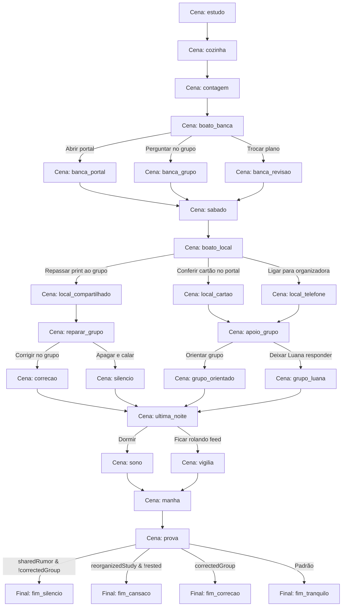

# Capítulo 1: Três anos de preparação

## Metadados do Capítulo
- **ID:** `chapter-01`
- **Número:** 1
- **Revisão:** 1
- **Título:** Três anos de preparação
- **Protagonista:** André (`andre`)
- **Contexto:** Um concurso fictício na reta final de uma preparação de três anos.
- **Cena Inicial:** `estudo`
- **Próximo Capítulo:** `chapter-02` (O que chegou ao grupo)

---

## Variáveis Iniciais de Estado
As variáveis controlam as ramificações e reações narrativas conforme as escolhas do jogador:
- `reorganizedStudy`: `false` (Indica se André mudou o plano de estudos por causa de boatos)
- `askedGroup`: `false` (Indica se André perguntou ao grupo sobre o comunicado oficial)
- `checkedCard`: `false` (Indica se André conferiu o próprio cartão de confirmação oficial)
- `calledOrganizer`: `false` (Indica se André tentou telefonar para a organizadora)
- `sharedRumor`: `false` (Indica se André repassou o boato/print para o grupo)
- `correctedGroup`: `false` (Indica se André enviou correção no grupo desmentindo o boato)
- `helpedGroup`: `false` (Indica se André enviou instruções oficiais para orientar o grupo)
- `rested`: `false` (Indica se André foi dormir e descansou adequadamente na véspera)

---

## Recursos Visuais (Assets)
### Retratos de Expressões de André
- **Normal:** `characters/andre/01_normal.png`
- **Feliz:** `characters/andre/02_feliz.png`
- **Triste:** `characters/andre/03_triste.png`
- **Surpreso:** `characters/andre/05_surpreso.png`
- **Constrangido:** `characters/andre/06_constrangido.png`
- **Pensativo:** `characters/andre/07_pensativo.png`

---

## Fluxo das Cenas

---

## Cenas Detalhadas

### 1. `estudo`
- **Ato:** Ato 1 · A preparação
- **Ambiente/Cenário:** Quarto de estudos · noite (`study`)
- **Próxima cena:** `cozinha`
- **Conteúdo:**
  - *Narração:* 21h47. A casa já estava quieta. André sublinhou a última linha e marcou uma questão que tinha errado pela terceira vez.
  - *Pensamento (André):* "Três anos. Ainda erro a mesma regra quando estou cansado."
  - *André (pensativo):* "Mais uma. Só mais uma."
  - *Narração:* De dia, ele atendia no balcão de uma papelaria. À noite, estudava para a vaga de assistente administrativo de Aurora do Vale.
  - *Narração:* Na primeira semana, conseguira vinte minutos de estudo. Agora conhecia o ruído do ventilador antes de qualquer página do caderno.
  - *Mãe:* "Deixei comida para você. Vem antes que esfrie de vez."
  - *André (normal):* "Já vou, mãe."
  - *Mãe:* "Você falou isso há meia hora."
  - *André (feliz):* "Dessa vez eu vou mesmo."

---

### 2. `cozinha`
- **Ato:** Ato 1 · A preparação
- **Ambiente/Cenário:** Cozinha · noite (`home`)
- **Próxima cena:** `contagem`
- **Conteúdo:**
  - *Narração:* O caderno ficou aberto na mesa. André comeu em silêncio por um instante, olhando as datas riscadas no calendário.
  - *Mãe:* "O pessoal perguntou se você vai ao almoço de domingo."
  - *André (constrangido):* "Depois da prova eu apareço. Faz três aniversários que digo isso, eu sei."
  - *Mãe:* "Eu sinto falta de você lá. Mas sei por que está fazendo isso."
  - *André (normal):* "Com um salário certo, eu podia planejar o mês sem fazer conta no caixa."
  - *Mãe:* "Não precisa me prometer aprovação. Só não esquece de descansar até domingo."
  - *Narração:* Ela empurrou o prato para ele. André sorriu, mas seus olhos voltaram ao cronograma preso à geladeira.
  - *Pensamento (André):* "Falta pouco. Só não posso me perder agora."

---

### 3. `contagem`
- **Ato:** Ato 2 · A prova se aproxima
- **Ambiente/Cenário:** Quarto de estudos · sexta-feira (`study`)
- **Próxima cena:** `boato_banca`
- **Conteúdo:**
  - *Narração:* Na sexta-feira, o edital anotado dividia a mesa com o cartão de confirmação: Escola Municipal das Palmeiras, portões às 8h.
  - *Narração:* André acompanhava grupos de candidatos para saber de avisos. A maioria das mensagens falava de transporte, caneta e do calor previsto.
  - *André (pensativo):* "Se mudar alguma coisa em cima da hora, alguém avisa."
  - *Luana:* "Avisar, avisam. Confirmar é outra história."
  - *Luana:* "Salva o endereço do Portal do Candidato do Instituto Vereda. Grupo vira bagunça na véspera."
  - *Narração:* Ele colocou a página da organizadora nos favoritos. Logo depois, uma notificação cobriu o cartão na tela.

---

### 4. `boato_banca`
- **Ato:** Ato 3 · O primeiro boato
- **Ambiente/Cenário:** Celular · sexta-feira (`digital`)
- **Conteúdo:**
  - *Narração:* O perfil não oficial “Radar das Provas” anunciava: “BANCA ALTERADA. NOVO CONTEÚDO PARA DOMINGO”.
  - *Narração:* A imagem imitava um comunicado, mas não trazia número de publicação nem apontava para a organizadora.
  - *Pensamento (André - surpreso):* "Se isso for verdade, meu último fim de semana de revisão muda inteiro."
  - *Narração:* O telefone vibrou de novo. Três pessoas do grupo já tinham encaminhado a postagem.
- **Decisão:** *O que André faz com a notícia sobre a banca?*
  1. **Opção `portal`:** "Abrir o portal da organizadora pelo endereço salvo"
     - Destino: `banca_portal`
     - Efeitos: Nenhum
  2. **Opção `grupo`:** "Perguntar no grupo se alguém encontrou o comunicado oficial"
     - Destino: `banca_grupo`
     - Efeitos: `askedGroup = true`
  3. **Opção `revisar`:** "Trocar o plano de revisão para a suposta nova banca"
     - Destino: `banca_revisao`
     - Efeitos: `reorganizedStudy = true`

---

### 5. `banca_portal`
- **Ato:** Ato 4 · Primeiras decisões
- **Ambiente/Cenário:** Quarto de estudos · sexta-feira (`study`)
- **Próxima cena:** `sabado`
- **Conteúdo:**
  - *Narração:* André abriu o favorito. A página de avisos do Instituto Vereda continuava mostrando a mesma banca e o mesmo conteúdo.
  - *André (pensativo):* "Era a arte do edital com outra frase por cima."
  - *Luana:* "Ainda bem que você olhou lá, e não no link da postagem."
  - *Pensamento (André):* "Minha cabeça disparou antes de eu terminar de ler."

---

### 6. `banca_grupo`
- **Ato:** Ato 4 · Primeiras decisões
- **Ambiente/Cenário:** Celular · sexta-feira (`digital`)
- **Próxima cena:** `sabado`
- **Conteúdo:**
  - *André (pensativo):* "Alguém achou essa mudança no portal da organizadora?"
  - *Narração:* Vieram três respostas diferentes. Luana enviou o endereço que já tinha guardado; André abriu a página de avisos.
  - *André (normal):* "Achei. Não há mudança de banca nem de conteúdo."
  - *Narração:* Algumas pessoas agradeceram. Outras continuaram discutindo a imagem, agora com um lugar concreto para conferir.

---

### 7. `banca_revisao`
- **Ato:** Ato 4 · Primeiras decisões
- **Ambiente/Cenário:** Quarto de estudos · sexta-feira (`study`)
- **Próxima cena:** `sabado`
- **Conteúdo:**
  - *Narração:* André separou novos resumos e procurou provas da suposta banca. Duas horas depois, o cronograma já não fazia sentido.
  - *Mãe:* "Você não ia revisar legislação hoje?"
  - *André (surpreso):* "Disseram que trocaram a banca."
  - *Mãe:* "Quem disse?"
  - *Pensamento (André - triste):* "Eu não sei."
  - *Narração:* Ele abriu o portal que havia salvo. A organizadora continuava a mesma; as duas horas, não.

---

### 8. `sabado`
- **Ato:** Ato 4 · Primeiras decisões
- **Ambiente/Cenário:** Quarto de estudos · sábado (`study`)
- **Próxima cena:** `boato_local`
- **Conteúdo:**
  - *Narração (Condicional - se `reorganizedStudy == true`):* No sábado, André voltou ao plano original. A postagem sumira do perfil, mas a manhã que ele perdera não voltaria.
  - *Narração (Condicional - se `reorganizedStudy == false`):* No sábado, André seguiu a revisão que havia planejado. Ainda assim, voltava os olhos ao celular mais vezes do que gostaria.
  - *Luana:* "No grupo, tudo parece urgente hoje. Eu vou deixar o cartão aberto."
  - *André (normal):* "O meu diz Escola das Palmeiras. Anotei até o ônibus."
  - *Narração:* Às 18h, outra mensagem chegou. Dessa vez falava do local da prova.

---

### 9. `boato_local`
- **Ato:** Ato 4 · O segundo boato
- **Ambiente/Cenário:** Celular · sábado (`digital`)
- **Conteúdo:**
  - *Narração:* Um print afirmava: “LOCAL DE PROVA ALTERADO. CANDIDATOS DEVEM IR AO CENTRO CÍVICO”. No rodapé: “Compartilhe agora”.
  - *Narração:* Um adesivo vermelho cobria a origem do suposto comunicado. Havia dezenas de reações e nenhuma referência verificável.
  - *Pensamento (André - surpreso):* "Se eu aparecer no lugar errado, três anos acabam na porta de um prédio."
  - *Luana:* "Meu cartão continua mostrando a escola. O seu mudou?"
- **Decisão:** *Como André resolve a dúvida sobre o local?*
  1. **Opção `cartao`:** "Conferir o próprio cartão no Portal do Candidato"
     - Destino: `local_cartao`
     - Efeitos: `checkedCard = true`
  2. **Opção `telefone`:** "Buscar o contato oficial e tentar confirmar por telefone"
     - Destino: `local_telefone`
     - Efeitos: `checkedCard = true`, `calledOrganizer = true`
  3. **Opção `compartilhar`:** "Repassar o print ao grupo enquanto reorganiza o trajeto"
     - Destino: `local_compartilhado`
     - Efeitos: `sharedRumor = true`

---

### 10. `local_cartao`
- **Ato:** Ato 4 · A decisão sobre o local
- **Ambiente/Cenário:** Quarto de estudos · sábado (`study`)
- **Próxima cena:** `apoio_grupo`
- **Conteúdo:**
  - *Narração:* André digitou o endereço que havia salvo, entrou no Portal do Candidato e abriu seu cartão. Escola das Palmeiras, portões às 8h.
  - *Narração:* Na página de avisos da organizadora, não havia alteração do local. Ele respirou e manteve o trajeto planejado.
  - *André (normal):* "O meu também não mudou. Vou usar o cartão, não o print."
  - *Luana:* "Boa. Estou mandando o caminho do portal para quem perguntou."

---

### 11. `local_telefone`
- **Ato:** Ato 4 · A decisão sobre o local
- **Ambiente/Cenário:** Quarto de estudos · sábado (`study`)
- **Próxima cena:** `apoio_grupo`
- **Conteúdo:**
  - *Narração:* André buscou o número no próprio cartão, não na postagem. A gravação informou que o atendimento havia encerrado.
  - *André (triste):* "Justo na hora em que eu precisava falar com alguém."
  - *Narração:* Ele voltou ao portal da organizadora. Seu cartão ainda indicava Escola das Palmeiras e os avisos não anunciavam mudança.
  - *Pensamento (André - pensativo):* "O telefone não respondeu. O documento, sim."

---

### 12. `local_compartilhado`
- **Ato:** Ato 4 · A decisão sobre o local
- **Ambiente/Cenário:** Celular · sábado (`digital`)
- **Próxima cena:** `reparar_grupo`
- **Conteúdo:**
  - *André (surpreso):* "Gente, viram isso? Estão dizendo que mudou para o Centro Cívico."
  - *Narração:* A mensagem saiu com o print. Em minutos, outras pessoas perguntavam qual ônibus passava no novo endereço.
  - *Mãe:* "Eu tinha visto o trajeto da escola com você. Vou procurar outro?"
  - *André (pensativo):* "Espera. A Luana está falando que o cartão dela não mudou."
  - *Narração:* André abriu seu cartão no portal da organizadora: Escola das Palmeiras. O grupo, porém, ainda conversava sobre o Centro Cívico.

---

### 13. `reparar_grupo`
- **Ato:** Ato 5 · O que fica no grupo
- **Ambiente/Cenário:** Celular · sábado (`digital`)
- **Conteúdo:**
  - *Pensamento (André - constrangido):* "Fui eu que mandei. Muita gente já deve ter visto."
- **Decisão:** *O que André faz depois de conferir o cartão?*
  1. **Opção `corrigir`:** "Corrigir a mensagem e indicar o portal da organizadora"
     - Destino: `correcao`
     - Efeitos: `checkedCard = true`, `correctedGroup = true`
  2. **Opção `apagar`:** "Apagar o print e guardar a confirmação para si"
     - Destino: `silencio`
     - Efeitos: `checkedCard = true`

---

### 14. `correcao`
- **Ato:** Ato 5 · O que fica no grupo
- **Ambiente/Cenário:** Celular · sábado (`digital`)
- **Próxima cena:** `ultima_noite`
- **Conteúdo:**
  - *André (constrangido):* "Conferi meu cartão no Portal do Candidato. A prova continua na Escola das Palmeiras. O print que mandei não tem fonte; desculpem a confusão."
  - *Narração:* A resposta demorou alguns segundos. Depois, uma pessoa enviou o próprio cartão e outra apagou o print que havia repassado.
  - *Luana:* "Valeu por voltar aqui. Eu também fiquei com medo quando vi."
  - *Pensamento (André - normal):* "Eu queria ter conferido antes. Pelo menos ainda dá tempo de avisar."

---

### 15. `silencio`
- **Ato:** Ato 5 · O que fica no grupo
- **Ambiente/Cenário:** Celular · sábado (`digital`)
- **Próxima cena:** `ultima_noite`
- **Conteúdo:**
  - *Narração:* André apagou a própria mensagem. No celular dele, o print sumiu; nas respostas do grupo, o Centro Cívico continuou aparecendo.
  - *Luana:* "Ainda tem gente perguntando para onde vai amanhã."
  - *Pensamento (André - constrangido):* "Se eu falar agora, vão saber que fui eu que espalhei."
  - *Narração:* Ele colocou o cartão oficial ao lado dos documentos. O silêncio não resolveu a conversa dos outros.

---

### 16. `apoio_grupo`
- **Ato:** Ato 5 · O que fica no grupo
- **Ambiente/Cenário:** Celular · sábado (`digital`)
- **Conteúdo:**
  - *Luana:* "Tem gente no grupo perguntando como achar o cartão. Eu mando o caminho?"
- **Decisão:** *André ainda está cansado. O que responde?*
  1. **Opção `orientar`:** "Enviar o caminho do portal oficial para o grupo"
     - Destino: `grupo_orientado`
     - Efeitos: `helpedGroup = true`
  2. **Opção `descansar`:** "Deixar Luana responder e voltar aos preparativos"
     - Destino: `grupo_luana`
     - Efeitos: Nenhum

---

### 17. `grupo_orientado`
- **Ato:** Ato 5 · O que fica no grupo
- **Ambiente/Cenário:** Celular · sábado (`digital`)
- **Próxima cena:** `ultima_noite`
- **Conteúdo:**
  - *André (normal):* "Entrem pelo endereço da organizadora que consta no edital e abram o próprio cartão. Não usem o link do print."
  - *Narração:* Uma candidata respondeu que tinha encontrado o local dela. Era diferente do de André, como podia acontecer, mas nenhum deles indicava o Centro Cívico.
  - *Pensamento (André - pensativo):* "Um print igual para todo mundo não podia substituir cada cartão."

---

### 18. `grupo_luana`
- **Ato:** Ato 5 · O que fica no grupo
- **Ambiente/Cenário:** Quarto de estudos · sábado (`study`)
- **Próxima cena:** `ultima_noite`
- **Conteúdo:**
  - *André (normal):* "Pode mandar, Luana. Vou conferir meus documentos e tentar descansar."
  - *Narração:* Luana enviou o caminho da página oficial. André separou cartão, documento e duas canetas na mesa.
  - *Pensamento (André - pensativo):* "Agora só falta o despertador tocar."

---

### 19. `ultima_noite`
- **Ato:** Ato 5 · A véspera
- **Ambiente/Cenário:** Quarto de estudos · madrugada (`study`)
- **Conteúdo:**
  - *Narração:* À meia-noite, os documentos estavam prontos. O grupo ainda recebia mensagens: ônibus, boatos antigos e gente tentando acalmar quem não conseguia dormir.
  - *Mãe:* "Coloquei o despertador da cozinha também. Vai deitar?"
  - *Pensamento (André):* "Se eu olhar mais uma vez, talvez encontre alguma novidade. Ou só mais um susto."
- **Decisão:** *Como André passa as últimas horas antes da prova?*
  1. **Opção `dormir`:** "Guardar o celular e tentar dormir"
     - Destino: `sono`
     - Efeitos: `rested = true`
  2. **Opção `rolar`:** "Continuar acompanhando as mensagens"
     - Destino: `vigilia`
     - Efeitos: `rested = false`

---

### 20. `sono`
- **Ato:** Ato 5 · A véspera
- **Ambiente/Cenário:** Quarto de estudos · madrugada (`study`)
- **Próxima cena:** `manha`
- **Conteúdo:**
  - *André (normal):* "Vou deitar. Se houver algo oficial, o cartão e o portal continuam lá de manhã."
  - *Narração:* O sono não veio de imediato. Veio antes da próxima notificação, e isso já ajudou.

---

### 21. `vigilia`
- **Ato:** Ato 5 · A véspera
- **Ambiente/Cenário:** Quarto de estudos · madrugada (`study`)
- **Próxima cena:** `manha`
- **Conteúdo:**
  - *Narração:* André leu a mesma discussão três vezes. Nenhuma mensagem nova vinha da organizadora.
  - *André (triste):* "Agora eu durmo."
  - *Narração:* Quando apagou a luz, faltavam poucas horas para o despertador.

---

### 22. `manha`
- **Ato:** Ato 5 · O dia da prova
- **Ambiente/Cenário:** Caminho da prova · manhã (`morning`)
- **Próxima cena:** `prova`
- **Conteúdo:**
  - *Narração:* O despertador tocou antes do sol alcançar a janela. André conferiu documento, canetas e cartão mais uma vez.
  - *Narração (Condicional - se `reorganizedStudy == true`):* Os resumos que ele reorganizara às pressas ainda estavam espalhados. A mochila demorou um pouco mais para fechar.
  - *Narração (Condicional - se `rested == false`):* Tinha dormido pouco. No ônibus, as palavras do caderno pareciam distantes, mas o endereço do cartão estava claro.
  - *Narração (Condicional - se `rested == true`):* O descanso não afastou o nervosismo, mas deu a ele espaço para respirar antes de sair.
  - *Mãe:* "Seu cartão. E leva água."
  - *André (normal):* "Está tudo aqui. Volto depois do almoço."
  - *Narração:* O ônibus parou diante da Escola das Palmeiras. André viu outras pessoas com documentos na mão e entrou na fila.

---

### 23. `prova`
- **Ato:** Ato 6 · A prova
- **Ambiente/Cenário:** Escola das Palmeiras · manhã (`exam`)
- **Conteúdo:**
  - *Narração:* Ele chegou com tempo para encontrar a sala. O coração ainda acelerava, mas agora por um motivo que conhecia.
  - *Narração:* Na carteira, alinhou as canetas e o documento. A fiscal distribuiu as provas; o papel fez um ruído seco ao tocar a mesa.
  - *Pensamento (André - pensativo):* "Não preciso saber tudo. Preciso começar pela primeira questão."
  - *Narração:* Uma pergunta parecia familiar. Outra exigiu mais tempo. André seguiu página por página, sem saber ainda o resultado.
  - *Narração:* Quando saiu pelo portão, a manhã estava mais quente. Pela primeira vez em semanas, não havia nada a revisar.
- **Roteamento de Finais (Condições):**
  1. Se `sharedRumor == true` **E** `correctedGroup == false` &rarr; Ir para `fim_silencio`
  2. Se `reorganizedStudy == true` **E** `rested == false` &rarr; Ir para `fim_cansaco`
  3. Se `correctedGroup == true` &rarr; Ir para `fim_correcao`
  4. Caso padrão (Default) &rarr; Ir para `fim_tranquilo`

---

### 24. `fim_silencio` (Final)
- **Ato:** Ato 6 · Depois da prova
- **Ambiente/Cenário:** Casa · tarde (`after`)
- **Próxima cena:** Fim do capítulo (`chapterEnd`)
- **Conteúdo:**
  - *Narração:* No ônibus de volta, André encontrou mensagens de candidatos que tinham feito um desvio pelo Centro Cívico antes de achar a escola.
  - *Narração:* Ninguém perdera a prova no grupo, mas uma pessoa gastara a passagem que reservava para a semana.
  - *Pensamento (André - triste):* "Apagar a minha mensagem não apagou o caminho que ela fez."
  - *André (constrangido):* "Conferi no portal da organizadora. O local correto estava no cartão de cada um. Desculpem por eu não ter avisado antes."
  - *Narração:* Em casa, guardou o cartão entre os cadernos dos três anos de estudo. Não sabia se seria aprovado. Sabia que tinha chegado até a prova.
  - *Mãe:* "E agora?"
  - *André (feliz):* "Agora eu almoço com vocês."

---

### 25. `fim_cansaco` (Final)
- **Ato:** Ato 6 · Depois da prova
- **Ambiente/Cenário:** Casa · tarde (`after`)
- **Próxima cena:** Fim do capítulo (`chapterEnd`)
- **Conteúdo:**
  - *Narração:* A prova terminou. André lembrava de duas questões que poderia ter lido com mais calma; o cansaço da véspera pesara.
  - *André (triste):* "Cheguei lá. Mas fiquei correndo atrás de postagem quando precisava cuidar do que já sabia."
  - *Mãe:* "Você chegou, fez a prova e ainda pode descansar hoje. O resultado vem no tempo dele."
  - *Narração:* Ele empilhou os cadernos. Três anos não cabiam numa única manhã, nem desapareciam por causa de uma noite ruim.
  - *André (feliz):* "No domingo que vem eu vou ao almoço. Sem caderno."

---

### 26. `fim_correcao` (Final)
- **Ato:** Ato 6 · Depois da prova
- **Ambiente/Cenário:** Casa · tarde (`after`)
- **Próxima cena:** Fim do capítulo (`chapterEnd`)
- **Conteúdo:**
  - *Narração:* Luana enviou uma mensagem quando André saiu da escola: “Meu primo viu sua correção antes de pegar o ônibus. Obrigada.”
  - *Pensamento (André - normal):* "Eu devia ter conferido antes de enviar. Ainda bem que voltei para explicar."
  - *André (feliz):* "Terminei a prova. Não sei como fui, mas consegui estar lá."
  - *Mãe:* "Isso já merece um almoço sem cronograma."
  - *Narração:* André deixou o celular virado para baixo. Os cadernos continuariam ali; por aquela tarde, não precisava abrir nenhum.

---

### 27. `fim_tranquilo` (Final Padrão)
- **Ato:** Ato 6 · Depois da prova
- **Ambiente/Cenário:** Casa · tarde (`after`)
- **Próxima cena:** Fim do capítulo (`chapterEnd`)
- **Conteúdo:**
  - *Narração:* Ao sair da escola, André encontrou uma mensagem de Luana: “Também consegui fazer a prova. Depois a gente compara as questões.”
  - *André (feliz):* "Depois. Hoje eu não quero comparar nada."
  - *Narração:* Não sabia o resultado. Sabia que tinha protegido a chance pela qual estudara durante três anos.
  - *Mãe:* "O almoço de domingo ainda está de pé."
  - *André (feliz):* "Dessa vez eu apareço."
  - *Narração:* Ele guardou o cartão entre os cadernos e fechou a gaveta com cuidado.
